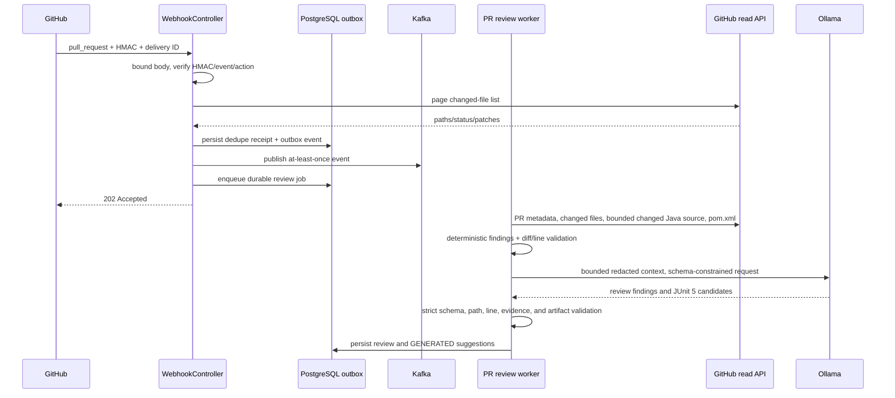

# AI pull-request review architecture

## Scope

The original release-risk pipeline remains authoritative for PASS/WARN/BLOCK.
The AI workflow persists a separate `REVIEW_*` result and never changes a
deterministic release verdict. Kafka remains at-least-once; the PostgreSQL
outbox makes webhook intake durable and delivery receipts suppress duplicate
GitHub deliveries without promising exactly-once processing.

## Pull request ingestion and review

Only changed files are submitted to the model. Java source retrieval is limited
to at most 8 changed `.java` files, 4,000 characters per file, and 20,000
characters total. Diffs are bounded by file count and total patch size. Missing
patches, binary files, unavailable source, and invalid model output result in
partial/insufficient or failed review status; they are never replaced with
invented contents.

`OllamaPullRequestReviewAgent` is separate from the existing CI
`OllamaTriageAgent`. Both use the configured Ollama-compatible endpoint and
redaction patterns. Review JSON is schema-constrained and parsed into typed
records. Each finding must use a retrieved changed path, actual changed line,
supported LEFT/RIGHT diff side, and exact evidence line from the diff or
retrieved source. Confidence is a qualitative label, not a probability.

The deterministic rules and service graph findings are included as context.
They remain authoritative only in the existing release pipeline; AI severity
does not become a release BLOCK.

## Candidate generation and approval

Test generation is implemented for Java/Maven projects where the retrieved
`pom.xml` shows JUnit Jupiter or `spring-boot-starter-test`. Artifacts must be
new files under `src/test/java`, use JUnit 5, reference a changed source line,
and stay under the configured response bounds. Mockito is accepted only where
the project's Maven configuration indicates it is present. Python and
JavaScript generation are not implemented.

Candidates are stored as text with a SHA-256 hash and are never applied or
executed by Release Sentinel. Each tenant-scoped API key maps to a reviewer ID;
approval/rejection records the reviewer, timestamp, and rejection reason.
Export requires APPROVED and changes the state to EXPORTED. A developer must
apply, inspect, and commit it independently.

## Validation and state

Only APPROVED or EXPORTED suggestions can be bound. The server checks GitHub's
commit-to-pull-request association and verifies each candidate file's content
at that exact SHA byte-for-byte before atomically storing one binding per
review: repository, PR, source review SHA, validation commit SHA, accepted
suggestion IDs, artifact aggregate hash, and timestamp. Conflicting rebinding
is rejected. The repository still needs an unprivileged workflow to compile and
execute that committed test file; Release Sentinel has no isolated patch
runner.

CI reports use a tenant-scoped HMAC-SHA256 signature over
`timestamp.body`, a five-minute timestamp window, exact workflow-run URL, exact
repository/PR/SHA binding, the protected workflow name/path, test-step
conclusion, and test counts. Run ID is idempotent: identical repeats return the
existing result; conflicting payloads are rejected. A suggestion becomes
VALIDATED only when the configured workflow identity and test step completed
successfully and at least one test ran with no failures. The service trusts the
HMAC reporter's workflow metadata; it does not independently attest workflow
contents. Protecting that workflow and verifying workflow-definition changes
remain deployment requirements. Failure, missing test execution, or a
successful build with zero tests cannot yield VALIDATED.

## Persistence

PostgreSQL is used because no existing durable query store exists, and review
state requires transactional transitions and multi-instance locking. Kafka
remains transport. Flyway `V1` adds tables only; no existing rows are migrated
or removed. See [ADR_PR_REVIEW_PERSISTENCE.md](ADR_PR_REVIEW_PERSISTENCE.md)
for forward/rollback and backup details.

## API

All `/api` endpoints require a tenant/user bearer key configured in
`SENTINEL_API_TOKENS` as a JSON object keyed by `tenant/reviewer`, for example
`{"acme/alice":"<32-character-or-longer-secret>"}`. Tenant identity comes
from that credential, never from a request body. CI report and resolve
endpoints use a separate tenant HMAC key map in `SENTINEL_CI_TOKENS`.

| Endpoint | Purpose |
| --- | --- |
| `POST /api/reviews` | Analyze `{repository,pullRequestNumber}` |
| `GET /api/reviews?limit=50&offset=0` | Tenant-scoped review list |
| `GET /api/reviews/{id}` | Review and suggestions |
| `POST /api/reviews/{id}/reanalyze` | Re-fetch and create a new analysis attempt |
| `GET /api/reviews/{id}/findings` | Validated findings |
| `GET /api/reviews/{id}/test-suggestions` | Candidate suggestions and state |
| `POST /api/test-suggestions/{id}/under-review` | Enter review state |
| `POST /api/test-suggestions/{id}/approve` | Approve candidate |
| `POST /api/test-suggestions/{id}/reject` | Reject with required reason |
| `GET /api/test-suggestions/{id}/artifact` | Inspect candidate source |
| `GET /api/test-suggestions/{id}/export` | Export only approved source |
| `POST /api/reviews/{id}/bind-validation-commit` | Bind accepted IDs to PR-associated SHA |
| `POST /api/validation-bindings/resolve` | CI-authenticated lookup by repo/PR/SHA |
| `POST /api/reviews/{id}/ci-results` | CI-authenticated workflow report |
| `GET /api/reviews/{id}/validation` | Binding, runs, and suggestion states |

Request IDs are returned in `X-Request-Id`. Errors use `{timestamp,status,code,message,requestId}`. Unknown/malformed output, state conflicts, bad credentials, and missing reviews use structured HTTP errors.

## Observability and limits

Metrics use bounded status, severity, category, operation, or outcome labels;
they contain no repository, source, tenant, token, or PR-description labels.
Logs carry delivery/review IDs where applicable and do not log source or
credentials. The model remains optional to the original pipeline; real
Ollama-review metrics are not claimed until an actual model run is recorded.

Known limits: GitHub.com REST API only; one Ollama-compatible review provider;
JUnit 5 only; no Java parser/compiler check for generated candidates; GitHub
workflow trust depends on protecting the documented workflow file with
repository review rules; no automatic retention expiry; local Ollama results
are not benchmarked until a real run is captured. The evaluation methodology
is separate in [AI_REVIEW_EVALUATION.md](AI_REVIEW_EVALUATION.md).
