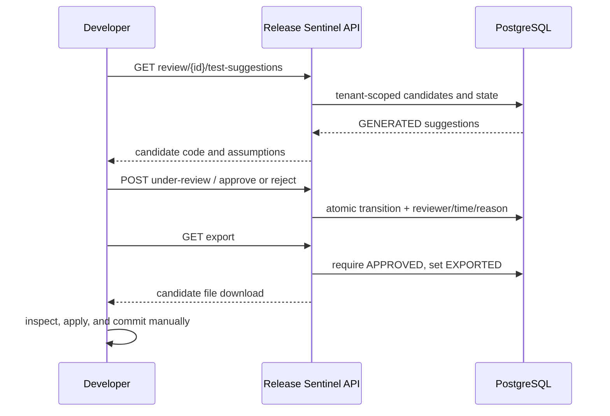
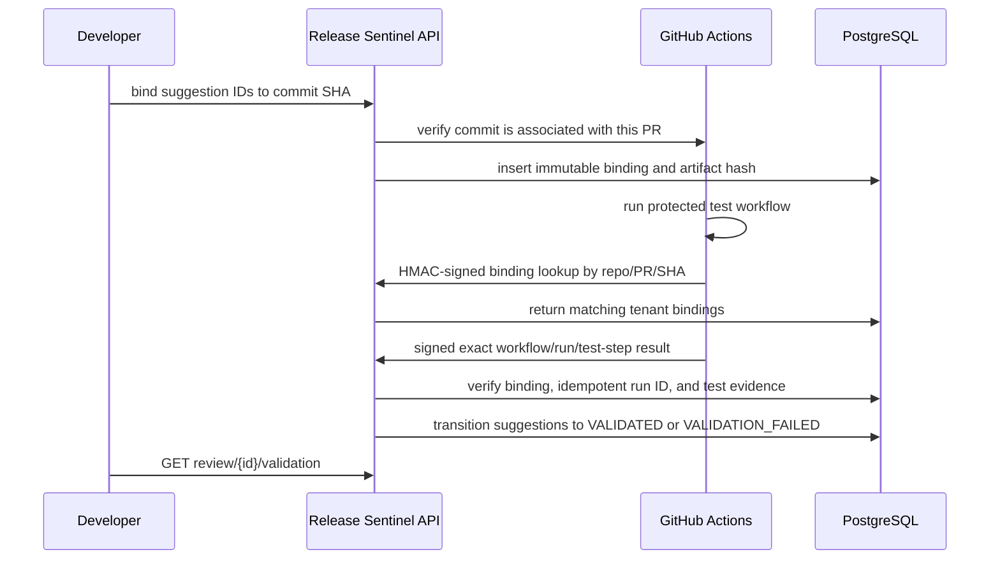

# Test suggestion workflow

## Implemented lifecycle

PR event processing and API review create durable findings and candidate
artifacts. The LLM proposes; deterministic validation checks output schema,
changed paths, diff line side/range, exact evidence, candidate path, size, and
JUnit 5 conventions. A candidate is never written into a source checkout or
executed by Release Sentinel.

```text
GENERATED -> UNDER_REVIEW -> APPROVED -> EXPORTED -> VALIDATION_PENDING
                       `-> REJECTED                       |-> VALIDATED
                                                         `-> VALIDATION_FAILED
```

Each `/api` bearer key maps to a configured `tenant/reviewer` identity. Approval
and rejection persist actor, timestamp, and decision reason. An authenticated
caller can inspect artifacts while they are generated; export requires
`APPROVED` and returns a downloadable file. Export changes status to EXPORTED
and is idempotent. The developer applies and commits the candidate manually.

### Approval and export



### CI validation



## Supported generation

Only Java Maven repositories whose `pom.xml` shows JUnit Jupiter or
`spring-boot-starter-test` currently receive suggestions. Mockito may be used
when it is present in the project's dependency configuration. Other frameworks
are unsupported. The current candidate validator checks structure, safety,
framework imports, and paths; it does not compile or execute candidates. A
human must review assumptions and generated code before approval.

Suggestions reference an actual changed source path and changed line. Generated
artifact paths must be new `src/test/java/...Test.java` paths. There is no API
to overwrite an existing repository file, push code, commit, or merge. The
developer repository executes accepted code in its own GitHub Actions runner.

## Persistence and tenant boundaries

PostgreSQL/Flyway stores reviews, candidate artifacts, approval decisions,
bindings, and CI results durably. Every query/state transition includes the
authenticated tenant. Possession of a UUID is not authorization. See
[AI_PR_REVIEW_ARCHITECTURE.md](AI_PR_REVIEW_ARCHITECTURE.md) and
[ADR_PR_REVIEW_PERSISTENCE.md](ADR_PR_REVIEW_PERSISTENCE.md).

No automatic data expiry is configured. Back up the PostgreSQL volume and
choose retention under the deployment's data policy.
